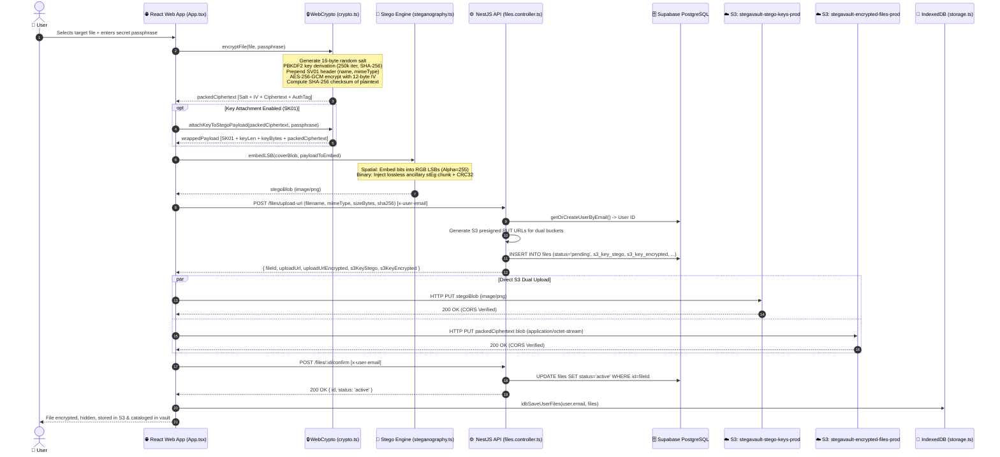
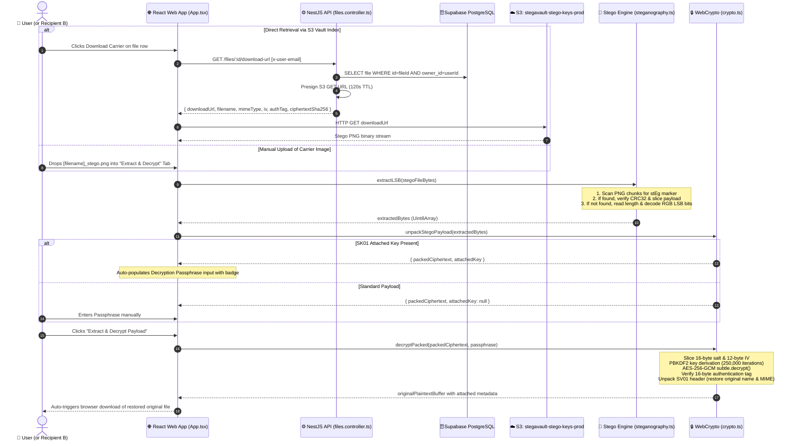

# Secure Cloud Storage: Production System Architecture & Data Flow

This document provides a source-backed architecture visualization of the **Secure Cloud Storage** project based strictly on the production codebase.

---

## 1. High-Level System Architecture Diagram

```mermaid
flowchart TB
    %% External Actors & Providers
    User(["👤 End User / Security Operator"])
    GoogleOAuth["🔐 Google Identity Services<br/>(OAuth 2.0 / UserInfo API)"]

    %% Client-Side Sandbox Boundary
    subgraph ClientSandbox ["🌐 BROWSER RUNTIME (Zero-Knowledge Trust Boundary)"]
        direction TB

        subgraph WebApp ["React 19 / Vite Application (apps/web)"]
            UI["Dashboard & Form Interfaces<br/>(App.tsx / LandingPage.tsx)"]
            AuthClient["Client Auth Controller<br/>(@react-oauth/google)"]
            APIClient["Backend API Client<br/>(api.ts)"]
        end

        subgraph CryptoEngine ["Browser Cryptographic Engine (crypto.ts)"]
            PBKDF2["PBKDF2 Key Derivation<br/>(250,000 iterations, SHA-256)"]
            AES["AES-256-GCM Hardware Engine<br/>(WebCrypto subtle.encrypt / decrypt)"]
            Packer["Wire Formatter & Checksums<br/>(SV01 Meta / SK01 Key / SHA-256)"]
        end

        subgraph StegoEngine ["Dual-Layer Steganography Engine (steganography.ts)"]
            CanvasLSB["Spatial 1-Bit LSB Embedding<br/>(RGB Channels / Alpha locked to 255)"]
            ChunkInjector["Lossless Ancillary Chunk Injector<br/>(PNG stEg Chunk + CRC32)"]
            Extractor["Stego Payload Extractor<br/>(stEg chunk priority -> LSB fallback)"]
        end

        subgraph ClientStorage ["Browser Local Storage (storage.ts)"]
            IDB[("IndexedDB: stegavault_db<br/>(Carrier Blobs & Index Cache)")]
            LStore[("localStorage<br/>(Session & User Metadata)")]
        end
    end

    %% Backend Tier Boundary
    subgraph BackendTier ["⚙️ BACKEND API TIER (apps/api - NestJS on Render)"]
        direction TB

        Controller["FilesController<br/>(/files endpoints)"]
        AuthController["AuthController<br/>(/auth/oauth routes)"]

        subgraph Modules ["NestJS Core Modules"]
            FilesMod["FilesModule & FilesService<br/>(Presigning & S3 Lifecycle)"]
            AuthMod["AuthModule<br/>(Passport Strategies)"]
            PrismaMod["PrismaModule & PrismaService<br/>(Direct Supabase Pooler)"]
        end
    end

    %% Database Tier
    subgraph DatabaseTier ["🗄️ RELATIONAL DATABASE (Supabase PostgreSQL)"]
        direction TB
        PGDB[("PostgreSQL Database Engine<br/>(Port 5432 Direct / 6543 Pooler)")]
        TableFiles["Table: files<br/>(Catalog, S3 Keys, Status, Hashes)"]
        TableUsers["Table: users<br/>(Owner UUIDs, Quota, Isolation)"]
        TableShares["Tables: shares, access_logs, refresh_tokens"]
        PGDB --- TableFiles
        PGDB --- TableUsers
        PGDB --- TableShares
    end

    %% Cloud Storage Tier
    subgraph StorageTier ["☁️ CLOUD OBJECT STORAGE (Amazon Web Services S3)"]
        direction TB
        BucketStego[("Bucket: stegavault-stego-keys-prod<br/>(Stego Carrier PNG Images: .png)")]
        BucketEnc[("Bucket: stegavault-encrypted-files-prod<br/>(Raw AES-256-GCM Ciphertext: .enc)")]
    end

    %% Relationships - Authentication
    User -->|"1. Initiates Google Sign-In"| AuthClient
    AuthClient -->|"2. OAuth 2.0 Token Exchange"| GoogleOAuth
    GoogleOAuth -->|"3. User Profile (email, name, avatar)"| AuthClient
    AuthClient -->|"4. Establishes Session"| LStore
    AuthClient -->|"5. Passes Identity Header (x-user-email)"| APIClient

    %% Relationships - Ingestion & Encryption
    User -->|"Uploads Original Plaintext File + Passphrase"| UI
    UI -->|"Raw File + Passphrase"| CryptoEngine
    PBKDF2 -->|"Derived 256-bit Key"| AES
    Packer -->|"Packaged SV01 Payload"| AES
    AES -->|"Packed Ciphertext [Salt+IV+Data+Tag]"| StegoEngine
    AES -->|"Raw Ciphertext Blob"| APIClient

    %% Relationships - Steganography
    CanvasLSB -->|"Pixel Embedded PNG"| StegoEngine
    ChunkInjector -->|"stEg Ancillary Injected PNG"| StegoEngine
    StegoEngine -->|"Stego PNG Blob"| APIClient
    StegoEngine -->|"Cache Carrier Preview"| IDB

    %% Relationships - API Handshake
    APIClient -->|"POST /files/upload-url [Metadata & SHA-256]"| Controller
    Controller --> FilesMod
    FilesMod -->|"Create Pending Record"| PrismaMod
    PrismaMod -->|"INSERT status='pending'"| TableFiles
    FilesMod -->|"S3 Presign PUT (uploadUrl)"| BucketStego
    FilesMod -->|"S3 Presign PUT (uploadUrlEncrypted)"| BucketEnc
    FilesMod -->|"Return Dual Presigned URLs"| APIClient

    %% Relationships - Direct S3 Transfers
    APIClient -->|"Direct PUT: stegoBlob (image/png)"| BucketStego
    APIClient -->|"Direct PUT: encryptedBlob (octet-stream)"| BucketEnc
    APIClient -->|"POST /files/:id/confirm"| Controller
    FilesMod -->|"UPDATE status='active'"| TableFiles

    %% Relationships - Retrieval & Decryption
    User -->|"Request Download / Decrypt"| UI
    UI -->|"GET /files/:id/download-url"| APIClient
    APIClient -->|"GET Download URL"| Controller
    FilesMod -->|"Verify Ownership & Presign GET"| BucketStego
    BucketStego -->|"Stream Carrier PNG"| APIClient
    APIClient -->|"Pass Stego Carrier"| Extractor
    Extractor -->|"Extract Packed Ciphertext"| AES
    User -->|"Provide Passphrase (or SK01 Auto-fill)"| CryptoEngine
    AES -->|"Decrypt & Verify Auth Tag"| Packer
    Packer -->|"Unpack SV01 & Restore Original File"| User
```

---

## 2. Secure Ingestion, Dual-Layer Steganography & Dual-S3 Upload Pipeline

---

## 3. S3 Presigned Retrieval, Stego Extraction & Decryption Pipeline

---

## 4. Component Implementation Inventory

| Component # | Component Name | Technology / Framework | Source Code Reference | Primary Responsibilities |
| :---: | :--- | :--- | :--- | :--- |
| **1** | **User / Operator** | Human Actor | Client Browser Session | Initiates file protection, defines passphrases, inspects audit logs, shares carriers. |
| **2** | **React Web App** | React 19, TypeScript, Vite, Tailwind CSS v4 | `apps/web/src/App.tsx` | Client application state, tab navigation, progress steps, responsive layout, and lifecycle coordinator. |
| **3** | **Client Authentication** | Google OAuth 2.0 (`@react-oauth/google`) | `apps/web/src/components/AuthModal.tsx`, `oauth.ts` | Client-side OAuth authentication, token decoding, session establishment, passing `x-user-email`. |
| **4** | **Browser Crypto Layer** | Native WebCrypto API (`window.crypto.subtle`) | `apps/web/src/lib/crypto.ts` | Real client-side PBKDF2 (250k iterations), AES-256-GCM encryption/decryption, SHA-256 checksums, `SV01`/`SK01` formatting. |
| **5** | **Steganography Layer** | HTML5 Canvas + PNG Binary Chunks | `apps/web/src/lib/steganography.ts` | 1-bit LSB spatial pixel encoding and lossless custom `stEg` ancillary chunk injection with CRC32. |
| **6** | **NestJS Backend API** | NestJS 11, Express, Node.js | `apps/api/src/files/files.controller.ts`, `files.service.ts` | Multi-bucket S3 presigning (PUT/GET), upload confirmation, file catalog querying, user auto-provisioning, and S3 cleanup. |
| **7** | **Relational Database** | Supabase PostgreSQL via Prisma ORM 7 | `apps/api/prisma/schema.prisma`, `prisma.service.ts` | Persistent file catalog (`files`), tenant isolation (`users`), sharing tokens (`shares`), and audit trails (`access_logs`). |
| **8** | **AWS S3 Stego Bucket** | Amazon S3 (`stegavault-stego-keys-prod`) | AWS `us-east-1`, S3 SDK v3 | Stores public/private steganographic PNG carrier files under key pattern `<ownerId>/<uuid>.png`. |
| **9** | **AWS S3 Encrypted Bucket** | Amazon S3 (`stegavault-encrypted-files-prod`) | AWS `us-east-1`, S3 SDK v3 | Stores raw AES-256-GCM encrypted ciphertext payloads under key pattern `<ownerId>/<uuid>.enc`. |
| **10** | **Browser Local Storage** | HTML5 IndexedDB & LocalStorage | `apps/web/src/lib/storage.ts` | Multi-megabyte persistent client cache for carrier image previews, vault indexes, and session tokens. |

---

## 5. Security Boundaries & Architecture Validation

1. **Zero-Knowledge Perimeter**:
   - **Boundary**: Browser Runtime $\leftrightarrow$ Cloud Network.
   - **Enforcement**: Plaintext files, passphrases, and derived CryptoKeys exist strictly in client-side ephemeral RAM. Only encrypted binary blobs and steganographic images traverse the network.
2. **Bandwidth & Compute Offloading**:
   - **Boundary**: Browser $\leftrightarrow$ AWS S3 Direct PUT/GET.
   - **Enforcement**: The NestJS API only issues cryptographic S3 presigned URLs. Large binary transfers bypass backend compute and RAM entirely.
3. **Multi-Tenant Relational Isolation**:
   - **Boundary**: Database Records & S3 Prefix Partitions.
   - **Enforcement**: All database queries are filtered by authenticated `ownerId`. S3 keys are partitioned into `<ownerId>/<fileUuid>.*` paths with ownership checks enforced before generating presigned download links.
4. **Cryptographic Tamper-Proofing**:
   - **Boundary**: Storage at Rest $\leftrightarrow$ In-Browser Decryption.
   - **Enforcement**: AES-256-GCM produces an immutable 16-byte authentication tag; any modification of the ciphertext at rest causes WebCrypto to immediately reject decryption with an integrity failure.
